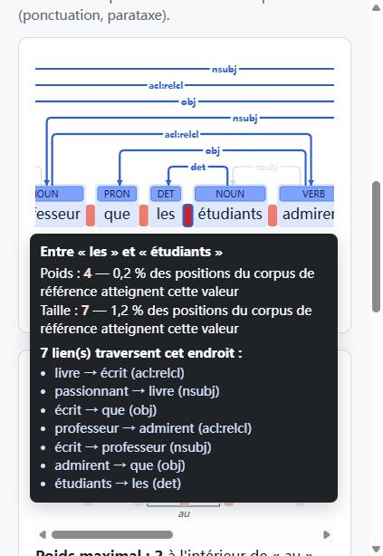

# flux_complexity

**Où ma phrase est-elle complexe ?** Un outil local, qui fonctionne entièrement sur votre ordinateur, pour
mesurer la complexité syntaxique avec le **flux de dépendance**. Il calcule deux indicateurs du flux, la
**taille** et le **poids**.

L'outil propose deux pages web :

| Page | Pour qui | Ce qu'elle fait |
|---|---|---|
| **Analyser un texte** (`/`) | tout le monde | Vous écrivez une phrase ou un paragraphe en français. Chaque phrase est affichée avec son arbre de dépendances, et les endroits où le flux est rare dans un corpus de référence sont surlignés en rouge. |
| **Corpus et expériences** (`/experiences`) | chercheurs | Vous importez un treebank CoNLL-U (UD ou SUD). Vous pouvez voir la distribution de la taille et du poids, la comparer à un corpus de référence, chercher des phrases (par valeur, par relation, par forme de la matrice de flux) et exporter toutes les positions en CSV. |



---

## Installation (une seule fois)

Il faut environ **2 Go** d'espace disque : Python et ses bibliothèques (dont PyTorch), plus le modèle
d'analyse syntaxique Stanza pour le français (environ 330 Mo). Il faut une connexion Internet pendant
l'installation ; ensuite, l'outil fonctionne hors ligne.

**1. Installer `uv`** (l'installateur Python ; il installe aussi Python si nécessaire).

- Windows (PowerShell) :
  ```powershell
  powershell -ExecutionPolicy ByPass -c "irm https://astral.sh/uv/install.ps1 | iex"
  ```
- macOS / Linux :
  ```bash
  curl -LsSf https://astral.sh/uv/install.sh | sh
  ```

Fermez puis rouvrez le terminal après l'installation.

**2. Récupérer ce dossier** (avec `git clone`, ou en téléchargeant l'archive ZIP puis en la décompressant),
puis ouvrez un terminal **dans le dossier `flux_complexity`**.

**3. Installer l'outil et télécharger le modèle français :**

```bash
uv tool install ".[web,parser]"
fluxcalc setup
```

`fluxcalc setup` télécharge le modèle Stanza la première fois (quelques minutes), puis vérifie qu'il
fonctionne.

> Si la commande `fluxcalc` n'est pas trouvée, lancez `uv tool update-shell`, puis fermez et rouvrez le
> terminal.

## Utilisation

```bash
fluxcalc serve
```

La page s'ouvre dans votre navigateur (adresse : <http://127.0.0.1:8000/>). Pour arrêter le serveur,
appuyez sur **Ctrl+C** dans le terminal.

- Le serveur n'écoute que sur votre ordinateur (`127.0.0.1`) : personne d'autre sur le réseau ne peut y
  accéder, il n'y a donc pas de compte ni de mot de passe.
- Au démarrage, le chargement de l'analyseur prend 10 à 20 secondes. La page l'indique, et le bouton
  « Analyser » s'active quand il est prêt.
- Les corpus importés sont enregistrés dans `~/.flux_complexity/data.sqlite3` (dans votre dossier
  personnel). Pour tout effacer, supprimez ce fichier. Les fichiers d'origine ne sont jamais modifiés.

Options utiles :

| Commande | Effet |
|---|---|
| `fluxcalc serve --port 8080` | utiliser un autre port |
| `fluxcalc serve --no-browser` | ne pas ouvrir le navigateur automatiquement |
| `fluxcalc serve --no-parser` | ne pas charger Stanza : seuls les fichiers CoNLL-U sont acceptés, et le démarrage est immédiat |
| `fluxcalc serve --db mon_projet.sqlite3` | utiliser une autre base de données, par exemple une par projet |

### En ligne de commande (sans navigateur)

```bash
fluxcalc analyze "Le livre que le professeur que les étudiants admirent a écrit est passionnant."
fluxcalc compute corpus.conllu --scheme UD -o positions.csv --sentences phrases.csv
fluxcalc norms list
```

`compute` écrit une ligne par position de flux, au même format que l'export CSV de la page « Corpus et
expériences ». `fluxcalc --help` et `fluxcalc <commande> --help` listent toutes les options.

### Sans l'analyseur syntaxique

Si vous ne travaillez qu'avec des fichiers CoNLL-U déjà annotés, vous pouvez installer une version plus
légère, sans Stanza ni PyTorch :

```bash
uv tool install ".[web]"
fluxcalc serve --no-parser
```

## Comment le flux est calculé

- La **position** i est l'espace entre deux mots voisins. Le **flux** en i est l'ensemble des dépendances
  qui relient un mot à gauche de i à un mot à droite (Kahane, 2001).
- La **taille** est le nombre de ces dépendances. Le **poids** est le plus grand nombre de dépendances
  *disjointes*, c'est-à-dire qui ne partagent aucun mot (Kahane, Yan & Botalla, 2017 ; Yan, 2021).
- Avant le calcul, la ponctuation est retirée ; elle reste affichée. Par défaut, la relation `parataxis`
  est coupée, mais pas ses sous-types (`parataxis:insert`…). Les positions dont le flux est vide ne
  sont pas comptées.
- Sur la page « Analyser un texte », une position est colorée selon la proportion des positions du corpus
  de référence qui atteignent la même valeur ou plus. Seuils par défaut : 40 %, 5 % et 1 % pour le poids ;
  10 %, 5 % et 2 % pour la taille. Ils sont réglables dans « Options avancées ».

Toutes les règles de calcul, avec des exemples faits à la main qui servent aussi de tests, sont dans
[docs/spec.md](docs/spec.md).

**Référence :** Chunxiao Yan (2021). *Complexité syntaxique et flux de dépendance : études quantitatives
dans les treebanks Universal Dependencies.* Thèse de doctorat, Université Paris Nanterre.
<https://theses.hal.science/tel-03649621>

## Corpus de référence et licences

Les corpus de référence (« normes ») fournis avec l'outil contiennent **uniquement des distributions** :
combien de positions ont chaque valeur de taille et de poids. Aucune phrase des treebanks n'est incluse.
Ces distributions ont été calculées sur la version **r2.18** des treebanks suivants ;
`scripts/build_french_norms.py` permet de les recalculer.

| Treebank | Contenu | Licence | Source |
|---|---|---|---|
| Sequoia (UD et SUD) | français écrit : presse, Europarl, textes médicaux, Wikipédia | LGPL-LR | [UD_French-Sequoia](https://github.com/UniversalDependencies/UD_French-Sequoia), [SUD_French-Sequoia](https://github.com/surfacesyntacticud/SUD_French-Sequoia) |
| ParisStories (UD et SUD) | français parlé : récits | CC BY-SA 4.0 | [UD_French-ParisStories](https://github.com/UniversalDependencies/UD_French-ParisStories), [SUD_French-ParisStories](https://github.com/surfacesyntacticud/SUD_French-ParisStories) |
| Rhapsodie (UD et SUD) | français parlé | CC BY-SA 4.0 | [UD_French-Rhapsodie](https://github.com/UniversalDependencies/UD_French-Rhapsodie), [SUD_French-Rhapsodie](https://github.com/surfacesyntacticud/SUD_French-Rhapsodie) |

Si vous publiez des résultats obtenus avec ces normes, citez les treebanks comme le demande la page de
chacun d'eux. Pour Sequoia : Candito & Seddah (2012), *Le corpus Sequoia : annotation syntaxique et
exploitation pour l'adaptation d'analyseur par pont lexical*, TALN 2012.

**Analyseur syntaxique :** [Stanza](https://stanfordnlp.github.io/stanza/) (Stanford NLP, licence Apache
2.0), avec ses modèles « combined » pour le français. Le texte saisi est toujours analysé en UD et comparé à
une norme UD.

**Licence de flux_complexity :** MIT (voir [LICENSE](LICENSE)). Cette licence couvre le code de l'outil ; les normes gardent la licence des treebanks dont elles sont issues (tableau ci-dessus).

## Questions fréquentes

**Le modèle Stanza prend-il deux fois la place ?** Stanza télécharge ses fichiers via le cache de Hugging
Face, puis les copie dans son propre dossier. Lors d'un téléchargement fait par `fluxcalc`, la copie du
cache est supprimée automatiquement. Si un téléchargement plus ancien en a laissé une,
`fluxcalc setup --remove-duplicate` la supprime (environ 330 Mo). Pour mettre le modèle ailleurs, par
exemple sur un autre disque, définissez la variable d'environnement `FLUX_STANZA_DIR` avant
`fluxcalc setup`.

**L'analyse est-elle toujours juste ?** Non : l'analyse syntaxique automatique peut se tromper, surtout sur
les phrases longues ou peu usuelles. Pour un travail de recherche, importez de préférence des corpus annotés
à la main.

**Peut-on l'utiliser pour une autre langue ?** Le calcul fonctionne pour n'importe quelle langue en UD ou
en SUD (page « Corpus et expériences » ou `fluxcalc compute`). En revanche, les normes fournies et
l'analyseur du texte libre ne concernent que le français. `scripts/build_french_norms.py` montre comment
construire une norme à partir d'autres treebanks.

## Pour les développeurs

```bash
uv venv .venv
uv pip install -e ".[web,parser,dev]"
.venv/Scripts/python -m pytest -q      # macOS / Linux : .venv/bin/python
```

- `src/flux_complexity/core/` : lecture du CoNLL-U, prétraitement, calcul du flux (aucune dépendance web).
- `src/flux_complexity/web/` : API FastAPI, base SQLite, pages (JavaScript sans compilation).
- `scripts/compare_legacy.py` : comparaison avec les anciens scripts et les fichiers Excel de la thèse.
